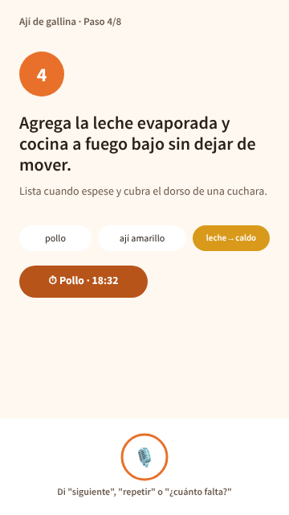
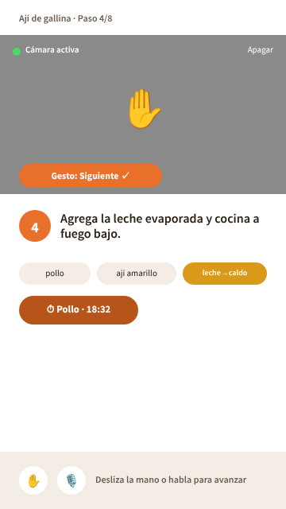
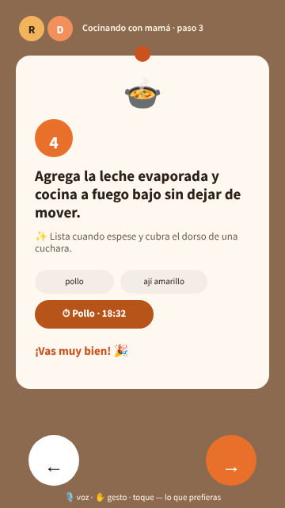

# 09 · Alternativas de diseño

**Proyecto:** Chef en el Aire, cocina manos libres
**Responsable:** Integrante 4 (Diseño e interacción)
**Base:** [Historias de usuario](07-historias-usuario.md) (HU-01 a HU-37), especialmente las de modo cocina (E3), voz (E4), gestos (E5), accesibilidad (E6), multiusuario (E8) y diseño emocional (E9).
**Herramienta:** [Penpot](https://penpot.app) (open source), vía su servidor MCP oficial — ver nota de herramientas en [`reparto-PC2-CC451.md`](../reparto-PC2-CC451.md).

Las tres alternativas muestran la misma pantalla crítica — **modo cocina, un paso con temporizador activo** (HU-09 a HU-13) — porque es donde más tensionan los requisitos obligatorios (voz, gestos, legibilidad a distancia, diseño emocional) y donde mejor se nota la diferencia entre enfoques. Bocetos exportados en [`diseno/bocetos/`](../diseno/bocetos/).

---

## 1. Las tres alternativas

### Alternativa A — Voz primero, tarjeta única

Pantalla minimalista de un solo bloque: número de paso grande, texto del paso en tipografía grande, chips de ingredientes y temporizador, y una barra inferior dedicada enteramente a la pista de voz ("Di 'siguiente', 'repetir'…"). El gesto y el toque existen como respaldo pero no tienen presencia visual — todo el espacio se dedica a que el paso se lea bien y a reforzar el canal de voz.

### Alternativa B — Gestos con cámara visible

La cámara ocupa el tercio superior de la pantalla de forma permanente, mostrando el gesto detectado en vivo ("Gesto: Siguiente ✓") y un indicador de "cámara activa" con opción de apagarla. El resto de la pantalla (paso, ingredientes, temporizador) se comprime para dejarle sitio. Abajo, una franja con iconos de gesto y voz en igualdad de condiciones.

### Alternativa C — Tablero cálido ilustrado

El paso se presenta como una tarjeta cálida "clavada" sobre un tablero de corcho, con ilustración del plato, microcopy celebratorio ("¡Vas muy bien! 🎉") y, arriba, los avatares de quienes cocinan juntos en la sala ("Cocinando con mamá · paso 3"). Voz, gesto y toque se mencionan por igual en una línea discreta al pie, sin que ninguno domine visualmente. Botones de navegación grandes y táctiles.

---

## 2. Comparación contra criterios de usabilidad

Los criterios son los que ya tienen métrica propia en las historias de usuario (no se inventan nuevos): así la comparación queda trazable a `RF`/`RNF` concretos y no depende de una opinión suelta.

| Criterio (con su HU/RNF) | A · Voz primero | B · Gestos + cámara | C · Tablero cálido |
|---|---|---|---|
| **Legibilidad a 1–2 m, texto ≥32 px** (RNF-07, CA-09.2) | ✅ Alta — todo el ancho es para el texto del paso | ❌ Baja — la cámara se come 1/3 de la pantalla; el texto del paso queda reducido y compite por espacio | ✅ Alta — jerarquía clara, la tarjeta deja aire al texto |
| **Carga/privacidad de la cámara** (RNF-11, CA-16.2/16.3) | ✅ N/A, no hay cámara en pantalla | ⚠️ Riesgo — cámara encendida y visible todo el tiempo, incluso para quien solo usa voz (ej. Rosa, Carmen) | ✅ N/A |
| **Diseño emocional — nivel visceral** (HU-30) | ⚠️ Cálido pero sobrio, sin ilustración | ❌ Panel de cámara gris, tono clínico, contradice "no una tarea técnica" | ✅ Ilustración, color, tablero cálido |
| **Diseño emocional — nivel reflexivo** (HU-32) | ❌ Sin celebración ni refuerzo | ❌ Sin celebración ni refuerzo | ✅ Microcopy celebratorio visible en la propia pantalla |
| **Multiusuario visible en modo cocina** (HU-28, requisito común obligatorio) | ❌ No se muestra | ❌ No se muestra | ✅ Avatares de participantes y su paso |
| **Soporte equitativo multicanal** (HU-12, voz/gesto/toque) | ⚠️ Sesga a voz (gesto/toque invisibles) | ⚠️ Sesga a gestos (la cámara domina) | ✅ Los tres canales se mencionan por igual |
| **Simplicidad / carga cognitiva** | ✅ Muy simple | ⚠️ Más elementos compitiendo (cámara + chips + franja) | ⚠️ Más elementos, pero jerarquizados en una sola tarjeta |

---

## 3. Alternativa elegida y justificación

**Se elige la Alternativa C — Tablero cálido ilustrado.**

Motivos, en orden de peso:

1. **Es la única que no sacrifica legibilidad a distancia** (RNF-07): A también cumple, pero B falla directamente por el espacio que le quita la cámara — un problema serio para una pantalla que se lee desde 1–2 m con las manos ocupadas.
2. **Cubre dos requisitos comunes obligatorios que las otras dos ignoran en esta pantalla**: diseño emocional (Norman) y multiusuario. B en particular va en contra del nivel visceral al poner un panel de cámara gris como elemento dominante.
3. **No privilegia visualmente un solo canal de entrada.** Tanto A (voz) como B (gestos) convierten su canal favorito en el centro de la pantalla, lo cual no calza con que los RF exigen que toda acción esencial esté disponible por al menos dos canales (HU-18, CA-18.3) sin que ninguno se sienta "secundario". C trata voz, gesto y toque como igualmente válidos.
4. **El riesgo de privacidad de B** (cámara siempre visible, incluso para perfiles que no la usan, como Rosa o Carmen) es un costo real que C evita por diseño, sin perder la posibilidad de activar gestos — simplemente no le da protagonismo visual permanente al feed de la cámara.

**Lo que se rescata de las otras dos alternativas** para el prototipo final:
- De A: la jerarquía tipográfica limpia y la barra de pista de voz como patrón reutilizable cuando el usuario está en modo "solo voz" (perfil de Carmen).
- De B: el patrón de confirmación visual de gesto reconocido ("Gesto: Siguiente ✓"), que se conserva como una notificación breve y no permanente (microinteracción, HU-31) en vez de un panel fijo.

**Riesgo a vigilar:** la ilustración y el fondo de corcho deben seguir funcionando en modo alto contraste (CA-30.2 ya lo anticipa: adaptar iconos e ilustraciones, no quitarlos) y la tarjeta no debe empujar contenido crítico fuera de la pantalla en equipos chicos (RNF-13, ≥360 px de ancho).

---

## 4. Siguiente paso

El prototipo de fidelidad media (Figma/Penpot) desarrolla la Alternativa C sobre las 6 pantallas del flujo principal — ver [`diseno/README.md`](../diseno/README.md) y el prototipo navegable enlazado desde el [README](../README.md).
