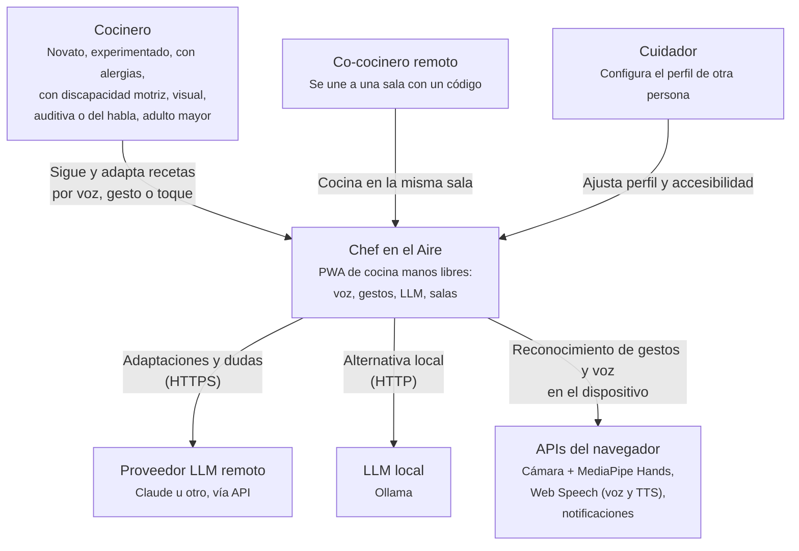
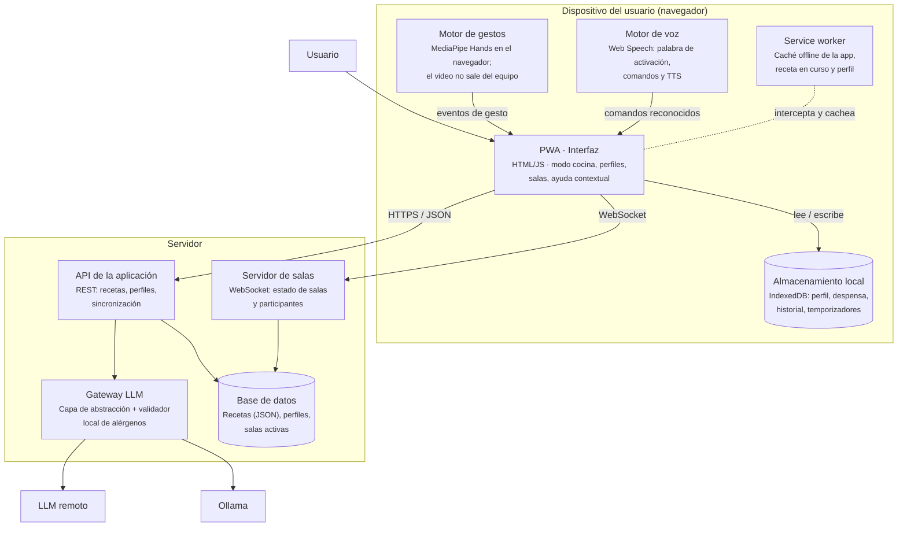
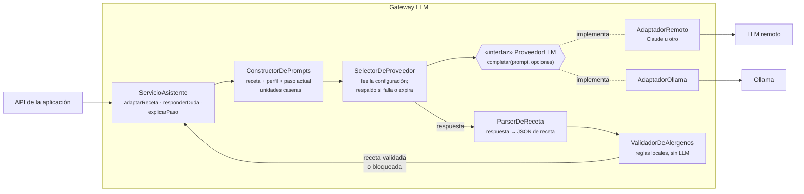
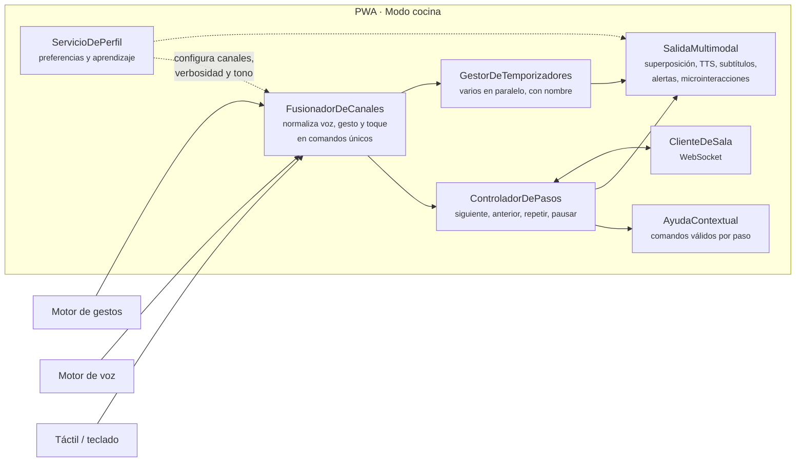

# Arquitectura (C4)

**Responsable:** Aarón Flores (Integrante 3)

Modelo C4 de **Chef en el Aire** en tres niveles: contexto, contenedores y componentes. Los diagramas están en Mermaid y GitHub los muestra directamente. Las referencias `RF-nn` / `RNF-nn` remiten a los requerimientos y `HU-nn` a las [historias de usuario](../07-historias-usuario.md).

---

## Nivel 1 · Contexto del sistema

Quién usa el sistema y con qué sistemas externos se relaciona.

---

## Nivel 2 · Contenedores

Piezas desplegables y cómo se comunican.

| Contenedor | Responsabilidad | Requerimientos |
|---|---|---|
| PWA · Interfaz | Pantallas, modo cocina, fusión de canales, diseño emocional | RF-01, RF-11 a RF-14, RF-24 a RF-27, RF-38 a RF-42; RNF-07, RNF-08, RNF-13 |
| Service worker | Instalación y funcionamiento sin conexión | RF-43, RF-44; RNF-10, RNF-15 |
| Motor de gestos | Detección local de gestos, sensibilidad configurable | RF-20 a RF-23; RNF-02, RNF-05, RNF-11 |
| Motor de voz | Palabra de activación, comandos, confianza, TTS | RF-15, RF-18, RF-19; RNF-01, RNF-04 |
| Almacenamiento local | Perfil persistente y estado de la receta en curso | RF-28 a RF-30; RNF-17, RNF-18 |
| API de la aplicación | Recetas, sincronización de perfiles, cuidador | RF-02 a RF-04, RF-32 |
| Gateway LLM | Interfaz única, adaptadores, respaldo, validación de alérgenos | RF-05 a RF-10, RF-13; RNF-03, RNF-06, RNF-14 |
| Servidor de salas | Crear/unirse, sincronizar pasos, resincronizar | RF-33 a RF-37; RNF-09 |

---

## Nivel 3 · Componentes

### Gateway LLM (capa de abstracción)

- **Cambiar de proveedor** = cambiar la configuración que lee `SelectorDeProveedor`. **Añadir un proveedor** = escribir un adaptador nuevo que implemente `ProveedorLLM` (RF-09, RNF-14).
- `SelectorDeProveedor` aplica el respaldo: proveedor alterno y, si también falla, receta sin adaptar con aviso (RF-10).
- `ValidadorDeAlergenos` corre **después** del LLM y no depende de él: compara cada ingrediente con los alérgenos del perfil y de los comensales (RF-07, RNF-06).

### PWA · Modo cocina

- `FusionadorDeCanales` garantiza que toda acción esencial llegue por al menos dos canales y que cada canal se pueda apagar (RF-12, RF-24).
- `SalidaMultimodal` emite cada evento por dos canales de salida: visual y audio (RF-17, RF-26, RF-39).
- `ClienteDeSala` publica los cambios de paso y aplica los recibidos según el modo de la sala (RF-34, RF-35).
