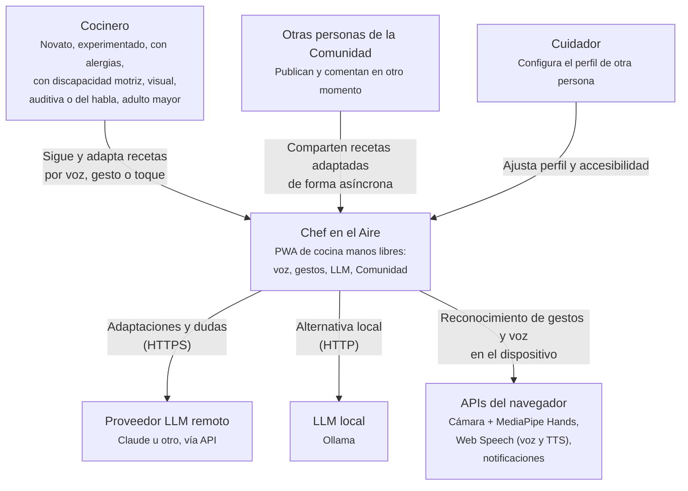
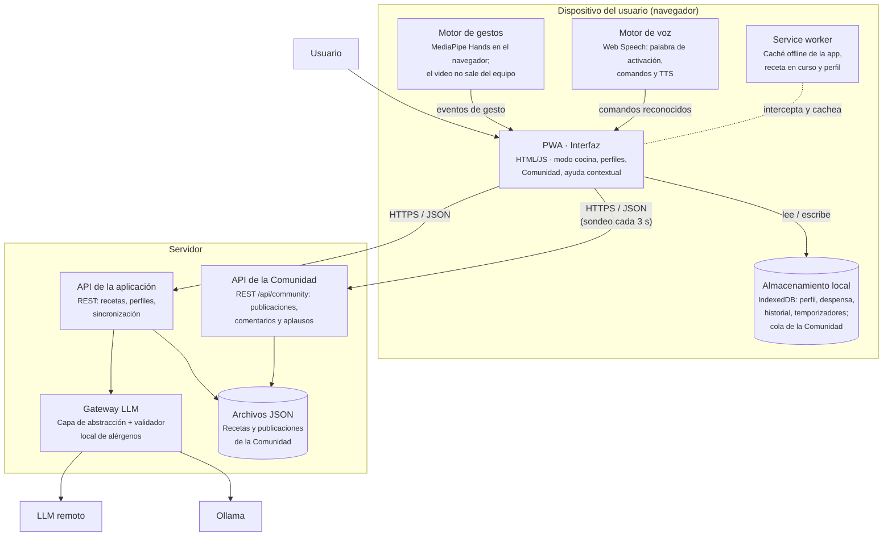
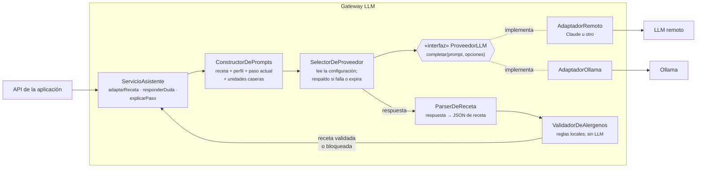
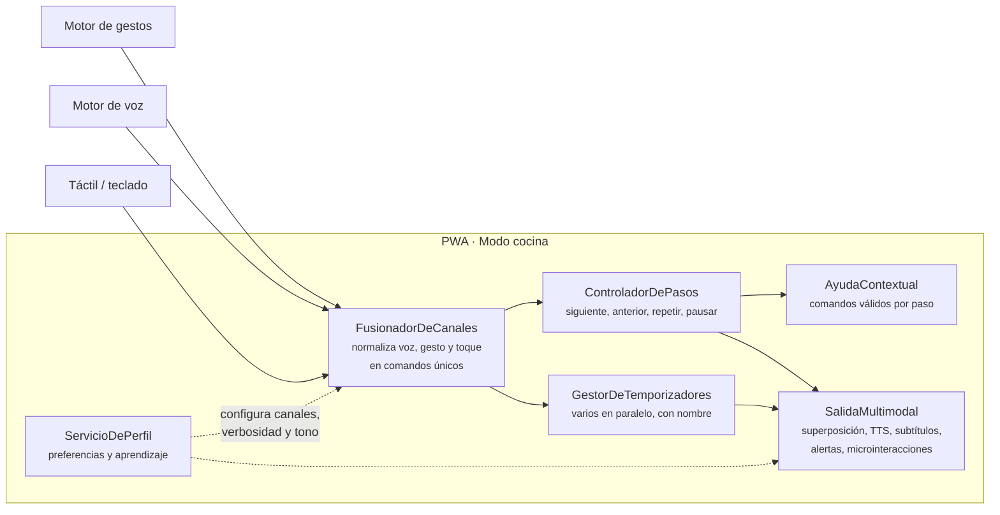
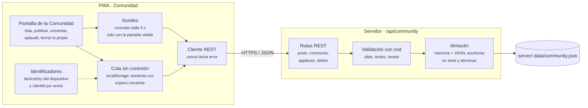

# Arquitectura (C4)

**Responsable:** Aarón Flores (Integrante 3)

Modelo C4 de **Chef en el Aire** en tres niveles: contexto, contenedores y componentes. Los diagramas están en Mermaid y GitHub los muestra directamente. Las referencias `RF-nn` / `RNF-nn` remiten a los requerimientos y `HU-nn` a las [historias de usuario](../07-historias-usuario.md).

---

## Nivel 1 · Contexto del sistema

Quién usa el sistema y con qué sistemas externos se relaciona.

---

## Nivel 2 · Contenedores

Piezas desplegables y cómo se comunican.

| Contenedor | Responsabilidad | Requerimientos |
|---|---|---|
| PWA · Interfaz | Pantallas, modo cocina, fusión de canales, diseño emocional | RF-01, RF-11 a RF-14, RF-24 a RF-27, RF-38 a RF-42; RNF-07, RNF-08, RNF-13 |
| Service worker | Instalación y funcionamiento sin conexión | RF-43, RF-44; RNF-10, RNF-15 |
| Motor de gestos | Detección local de gestos, sensibilidad configurable | RF-20 a RF-23; RNF-02, RNF-05, RNF-11 |
| Motor de voz | Palabra de activación, comandos, confianza, TTS | RF-15, RF-18, RF-19; RNF-01, RNF-04 |
| Almacenamiento local | Perfil persistente, estado de la receta en curso y cola sin conexión de la Comunidad | RF-28 a RF-30; RNF-17, RNF-18 |
| API de la aplicación | Recetas, sincronización de perfiles, cuidador | RF-02 a RF-04, RF-32 |
| Gateway LLM | Interfaz única, adaptadores, respaldo, validación de alérgenos | RF-05 a RF-10, RF-13; RNF-03, RNF-06, RNF-14 |
| API de la Comunidad | Publicar recetas adaptadas y logros, comentar, aplaudir y borrar lo propio; guarda todo en un archivo JSON | RF-33 a RF-37; RNF-09 |

---

## Nivel 3 · Componentes

### Gateway LLM (capa de abstracción)

- **Cambiar de proveedor** = cambiar la configuración que lee `SelectorDeProveedor`. **Añadir un proveedor** = escribir un adaptador nuevo que implemente `ProveedorLLM` (RF-09, RNF-14).
- `SelectorDeProveedor` aplica el respaldo: proveedor alterno y, si también falla, receta sin adaptar con aviso (RF-10).
- `ValidadorDeAlergenos` corre **después** del LLM y no depende de él: compara cada ingrediente con los alérgenos del perfil y de los comensales (RF-07, RNF-06).

### PWA · Modo cocina

- `FusionadorDeCanales` garantiza que toda acción esencial llegue por al menos dos canales y que cada canal se pueda apagar (RF-12, RF-24).
- `SalidaMultimodal` emite cada evento por dos canales de salida: visual y audio (RF-17, RF-26, RF-39).

### Comunidad (asíncrona)

La Comunidad es un espacio compartido sin tiempo real: las personas publican recetas adaptadas y logros, comentan y aplauden en el momento que les sirva. No hay conexión permanente; el cliente consulta cada pocos segundos.

Rutas (todas bajo `/api/community`):

| Método y ruta | Qué hace |
|---|---|
| `GET /posts` | Devuelve hasta 50 publicaciones, de la más reciente a la más antigua, y `serverTime` |
| `POST /posts` | Publica una receta adaptada o un logro; `201` si es nueva y `200` con la existente si el `clientId` ya llegó |
| `POST /posts/:id/comments` | Agrega un comentario; mismo criterio de idempotencia con su `clientId` |
| `POST /posts/:id/applause` | Suma un aplauso por dispositivo; repetirlo no lo cuenta dos veces |
| `DELETE /posts/:id` | Borra la publicación solo si la pide el dispositivo que la publicó (`403` en otro caso) |

- **Almacenamiento:** el almacén mantiene las publicaciones en memoria y las guarda en un JSON (`COMMUNITY_FILE`, por defecto `server/.data/community.json`). Las escrituras se encadenan en una sola cola y se hacen de forma atómica (archivo temporal y `rename`), así un corte no deja el archivo a medias. Se conservan como máximo 200 publicaciones (al pasarse se descartan las más antiguas) y 200 comentarios por publicación. Si el archivo no existe, se siembra con dos publicaciones de demostración.
- **Sondeo del cliente:** consulta cada 3 s solo mientras la pantalla está visible. Sin servidor, conserva lo último cargado y avisa que la Comunidad no está disponible (RNF-09).
- **Cola sin conexión:** publicar, comentar y aplaudir entran primero a una cola persistida en el dispositivo y se envían enseguida; lo que no llega se reintenta con una espera que crece (2 s, 4 s… hasta 60 s) y se descarta tras 6 intentos fallidos. Se vacía también al volver la conexión (RF-37, RNF-09).
- **Sin duplicados:** cada publicación y comentario lleva un `clientId` generado una vez; si la cola lo reenvía, el servidor devuelve el existente en lugar de crear otro.
- **Un aplauso por dispositivo y borrado de lo propio:** el dispositivo genera una `deviceKey` aleatoria que no identifica a la persona. El servidor la guarda **con hash (SHA-256)**, **nunca la devuelve** y solo la usa para saber quién aplaudió y quién puede borrar.
- **Validación:** el servidor está expuesto por el túnel, así que valida todo con zod (alias de hasta 30 caracteres, textos de hasta 500, receta con el mismo esquema del recetario) y responde errores en español sin detalles internos. Quien abre una receta publicada la pasa por su propio validador local de alérgenos (RF-35).

---

## Decisiones de arquitectura

### Asíncrono en vez de WebSocket (16/11/2026)

**Decisión:** el requisito multiusuario (RF-33 a RF-37) se cubre con la Comunidad, una API REST con sondeo del cliente, y no con salas en tiempo real sobre WebSocket.

**Motivo:** un servidor en tiempo real y las pruebas con varios dispositivos a la vez no caben en el tiempo restante, y cocinar con otros no exige coincidir en el horario. La Comunidad conserva el valor multiusuario (compartir recetas adaptadas, comentarlas y celebrar logros) sin sincronizar pasos ni mantener conexiones abiertas. Ver [alcance](../06-alcance.md), sección 4.

**Consecuencias:**

- Lo publicado se ve en los demás dispositivos con un retraso de unos segundos (el intervalo de sondeo), dentro del umbral de RNF-09 (≤ 5 s en el percentil 95).
- El servidor no guarda estado de conexiones: solo atiende pedidos REST y escribe su archivo JSON.
- Quedan fuera del alcance los pasos sincronizados, los avatares por participante y la resincronización.
