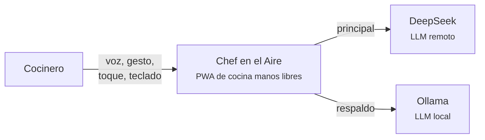
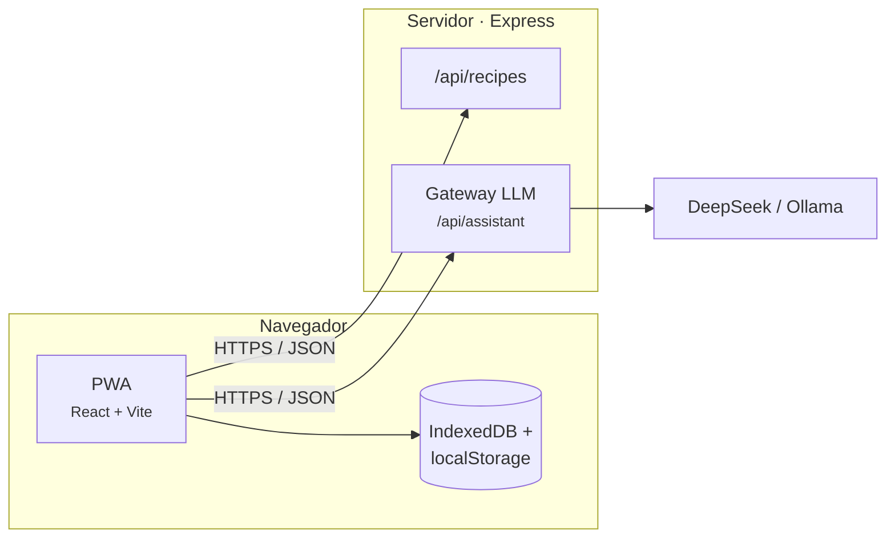
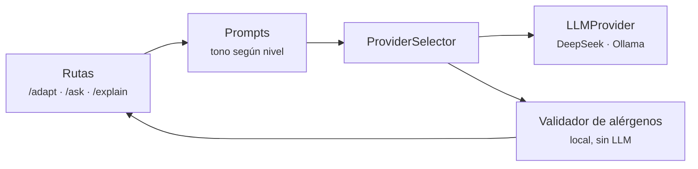
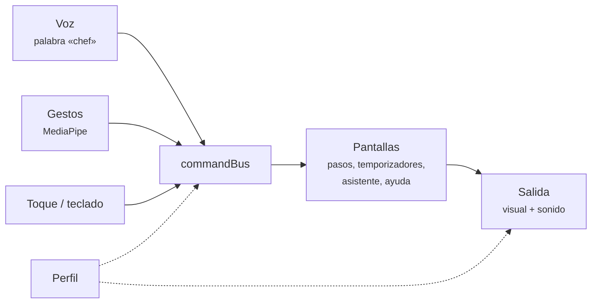

# Arquitectura implementada (C4)

Muestra lo que **está construido**. El diseño original está en [docs/arquitectura](../../arquitectura/README.md).

## Nivel 1 · Contexto

## Nivel 2 · Contenedores

| Contenedor | Qué hace | Código |
|---|---|---|
| PWA | Pantallas, voz, gestos, salida multimodal y perfil; funciona sin conexión gracias al service worker | [`app/`](https://github.com/Akira-13/chef-en-el-aire/tree/main/app/src) |
| IndexedDB + localStorage | Perfil (IndexedDB); receta en curso y temporizadores (localStorage) | [`profile/storage.ts`](https://github.com/Akira-13/chef-en-el-aire/blob/main/app/src/profile/storage.ts) |
| `/api/recipes` | Sirve el recetario de `datos/recetas.json` | [`server/src/app.ts`](https://github.com/Akira-13/chef-en-el-aire/blob/main/server/src/app.ts) |
| Gateway LLM | Adapta recetas, responde dudas, explica pasos | [`server/src/assistant`](https://github.com/Akira-13/chef-en-el-aire/tree/main/server/src/assistant) |

El paquete [`shared/`](https://github.com/Akira-13/chef-en-el-aire/tree/main/shared/src) lo usan tanto el cliente como el servidor. Ahí están los tipos, los comandos, la detección de alérgenos y el escalado de porciones. **Ninguna de esas reglas depende del LLM.**

## Nivel 3 · Componentes

### Gateway LLM

- **Respaldo:** si el proveedor principal falla o tarda más de 8 s, se usa el alterno. Si este también falla, el servidor responde «no disponible» y el cliente sigue mostrando la receta original (RF-10).
- **Agregar un proveedor:** basta con un adaptador nuevo que implemente [`LLMProvider`](https://github.com/Akira-13/chef-en-el-aire/blob/main/server/src/llm/LLMProvider.ts) (RNF-14).
- **Alérgenos:** el validador revisa toda receta adaptada y bloquea las que contengan alérgenos del perfil (RF-07, RNF-06).

### PWA · Modo cocina

- **Todos los canales publican el mismo comando** en [`commandBus`](https://github.com/Akira-13/chef-en-el-aire/blob/main/app/src/core/commandBus.ts). Gracias a eso, cada acción se puede hacer por al menos dos canales (RF-12, RF-24).
- **Privacidad:** el video de la cámara no sale del dispositivo (RNF-11).

## Diferencias con el diseño

| Diseño | Implementado |
|---|---|
| Servidor de salas (WebSocket) | No existe. Se replanteará como foros |
| Base de datos en el servidor | Archivos JSON; el perfil vive en el dispositivo |
| Claude como LLM remoto | DeepSeek, con Ollama como respaldo |
| — | Nuevo paquete `shared/` con reglas comunes |
