# Parte 3 · Evidencia de implementación

**Proyecto:** Chef en el Aire, cocina manos libres

Se presentan las evidencias de implementación de historias de usuario ([07](../../07-historias-usuario.md)) y los requerimientos funcionales y no funcionales ([05](../../05-requerimientos.md)), siguiendo la [matriz de trazabilidad](../../10-matriz-trazabilidad.md). Por cada historia se indican los criterios de aceptación cubiertos, los enlaces al código y a sus pruebas, y el espacio para las capturas de la aplicación en funcionamiento.

## 1. Resumen de cobertura

| Indicador | Total | Implementado | Parcial | No implementado |
|---|---|---|---|---|
| Requerimientos funcionales (RF) | 44 | 37 | 1 | 6 |
| Requerimientos no funcionales (RNF) | 18 | 11 | 5 | 2 |
| **Total** | **62** | **48** | **5** | **9** |

- **No implementado:** Funcionalidades multi-usuario, RF-33 a RF-37 y RNF-09 (Inicialmente se pensaban implementar salas de cocina, se consideran foros o lugares de discusión para la siguiente iteración), medición de tasa de aciertos de voz y gestos (RNF-04 y RNF-05)
- **Parcial:** Funcionalidades de accesibilidad (tono de LLM según emoción, revisión de estándar WCAG 2.1 AA).

## 2. Arquitectura y pruebas

Es un monorepo con tres paquetes:

- **Cliente.** [`app/`](https://github.com/Akira-13/chef-en-el-aire/blob/main/app/src): PWA en React con las pantallas, la entrada por voz y gestos, la salida en voz, subtítulos y sonidos, los temporizadores y el perfil.
- **Servidor.** [`server/`](https://github.com/Akira-13/chef-en-el-aire/blob/main/server/src): API en Express del asistente (`/adapt`, `/ask` y `/explain`) y la capa de abstracción del LLM.
- **Compartido.** [`shared/`](https://github.com/Akira-13/chef-en-el-aire/blob/main/shared/src): tipos, detector de alérgenos y escalado de porciones. Lo usan tanto el cliente como el servidor.

**Decisión clave.** Las reglas críticas no dependen del LLM. La detección de alérgenos se hace siempre en local, y si el LLM falla, la receta original sigue disponible.

**Pruebas.** Hay 49 archivos de Vitest con unos 417 casos. `npm run check` revisa el formato y los tipos, corre las pruebas y genera el build, y la CI ejecuta el mismo comando.

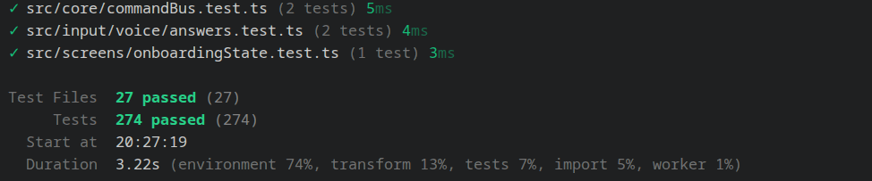

## 3. Evidencia por épica

✅ implementado · 🟡 parcial · ❌ no implementado. Cada enlace lleva a GitHub en la línea donde se define el módulo.

### E1 · Recetas y despensa

| HU | Req. | Estado | Evidencia |
|---|---|---|---|
| HU-01 Sugerencias | RF-01 | ✅ | [`suggestRecipes`](https://github.com/Akira-13/chef-en-el-aire/blob/main/app/src/personalization/suggest.ts#L62): 3 recetas filtradas; si nada cumple, relaja el tiempo, **nunca los alérgenos** · [test](https://github.com/Akira-13/chef-en-el-aire/blob/main/app/src/personalization/index.test.ts) |
| HU-02 Búsqueda | RF-02 | ✅ | [`searchRecipes`](https://github.com/Akira-13/chef-en-el-aire/blob/main/app/src/personalization/search.ts#L39), por voz con [`parseCommand`](https://github.com/Akira-13/chef-en-el-aire/blob/main/app/src/input/voice/parseCommand.ts#L88) |
| HU-03 Despensa | RF-03 | ✅ | [`pantryStatus`](https://github.com/Akira-13/chef-en-el-aire/blob/main/app/src/personalization/pantry.ts#L20) (tengo / falta / sustituir), [`PantryEditor`](https://github.com/Akira-13/chef-en-el-aire/blob/main/app/src/profile/ProfileSections.tsx#L18) |

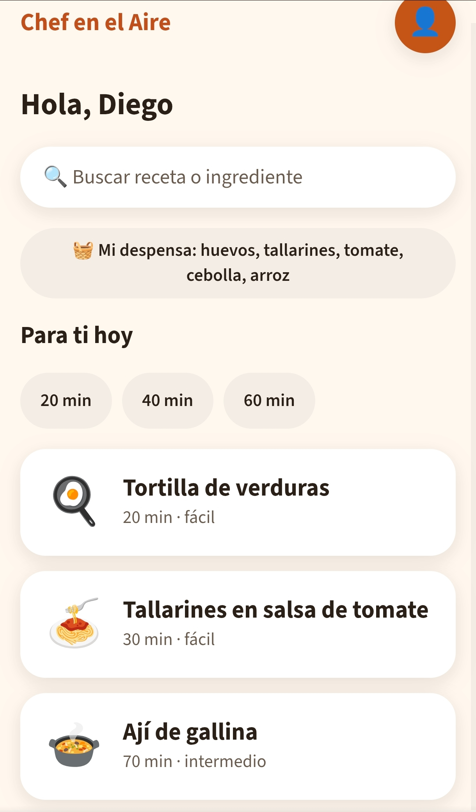

### E2 · Adaptación con LLM

| HU | Req. | Estado | Evidencia |
|---|---|---|---|
| HU-04 Adaptar receta | RF-04, RF-05 | ✅ | [`recetas.json`](https://github.com/Akira-13/chef-en-el-aire/blob/main/datos/recetas.json) (10 recetas), [`POST /adapt`](https://github.com/Akira-13/chef-en-el-aire/blob/main/server/src/assistant/routes.ts#L125), [`buildAdaptPrompt`](https://github.com/Akira-13/chef-en-el-aire/blob/main/server/src/assistant/prompts.ts#L59) · [test](https://github.com/Akira-13/chef-en-el-aire/blob/main/server/src/assistant/routes.test.ts) |
| HU-05 Antes / después | RF-06 | ✅ | [`AdaptationPanel`](https://github.com/Akira-13/chef-en-el-aire/blob/main/app/src/assistant/AdaptationPanel.tsx#L65): cambios con su motivo y «Usar original» · [test](https://github.com/Akira-13/chef-en-el-aire/blob/main/app/src/assistant/AdaptationPanel.test.tsx) |
| HU-06 Bloqueo de alérgenos | RF-07, RNF-06 | ✅ | [`findAllergens`](https://github.com/Akira-13/chef-en-el-aire/blob/main/shared/src/allergens/index.ts#L126): bloqueo hasta decir «confirmo» o tocar el botón · **[test 10 recetas × 4 perfiles = 100 %](https://github.com/Akira-13/chef-en-el-aire/blob/main/shared/src/allergens/index.test.ts)** |
| HU-07 Preguntar al asistente | RF-08, RNF-03 | ✅ | [`AssistantPanel`](https://github.com/Akira-13/chef-en-el-aire/blob/main/app/src/assistant/AssistantPanel.tsx#L104): usa el paso actual como contexto; «Pensando…» inmediato y latencia medida |
| HU-08 Cambiar de proveedor | RF-09, RF-10, RNF-14 | ✅ | [`LLMProvider`](https://github.com/Akira-13/chef-en-el-aire/blob/main/server/src/llm/LLMProvider.ts#L17) + adaptadores [DeepSeek](https://github.com/Akira-13/chef-en-el-aire/blob/main/server/src/llm/DeepSeekProvider.ts#L8) / [Ollama](https://github.com/Akira-13/chef-en-el-aire/blob/main/server/src/llm/OllamaProvider.ts#L6); [`ProviderSelector`](https://github.com/Akira-13/chef-en-el-aire/blob/main/server/src/llm/ProviderSelector.ts#L29) pasa al alterno · **nuevo proveedor = 1 adaptador** |

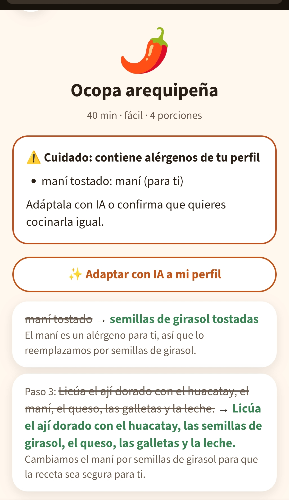

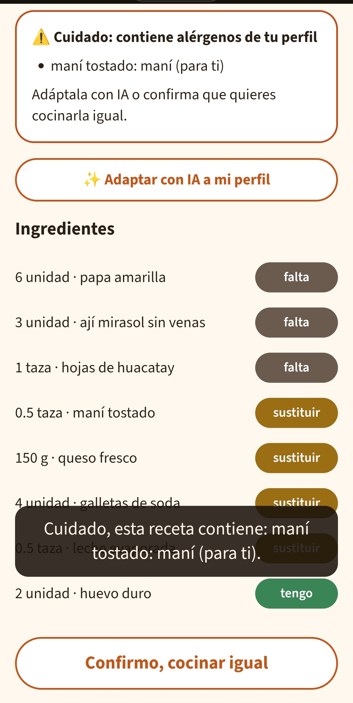

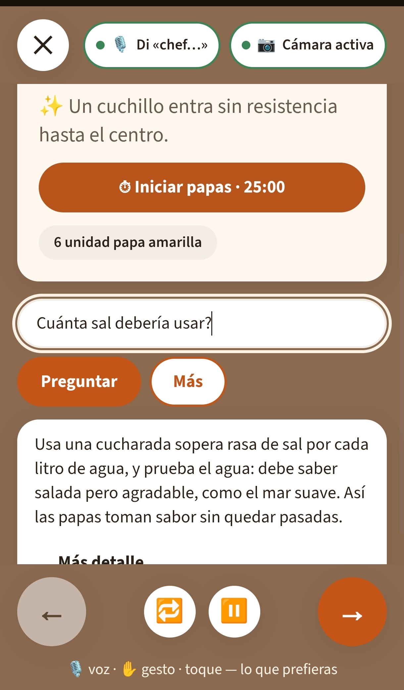

### E3 · Modo cocina y temporizadores

| HU | Req. | Estado | Evidencia |
|---|---|---|---|
| HU-09 Un paso en grande | RF-11, RNF-07 | ✅ | [`CookingScreen`](https://github.com/Akira-13/chef-en-el-aire/blob/main/app/src/screens/CookingScreen.tsx#L61); [`tokens.css`](https://github.com/Akira-13/chef-en-el-aire/blob/main/app/src/theme/tokens.css): texto de 32 px y contraste ≥ 4,5:1 (≥ 7:1 en alto contraste) |
| HU-10 Cuándo está listo | RF-13 | ✅ | `step.readyCue` y [`buildExplainPrompt`](https://github.com/Akira-13/chef-en-el-aire/blob/main/server/src/assistant/prompts.ts#L162) |
| HU-11 Temporizadores | RF-16, RNF-18 | ✅ | [`startTimer`](https://github.com/Akira-13/chef-en-el-aire/blob/main/app/src/cooking/timers.ts#L47), «¿cuánto falta?»; el tick corre en un [Web Worker](https://github.com/Akira-13/chef-en-el-aire/blob/main/app/src/cooking/tickWorker.ts) y se mide el desfase · [test](https://github.com/Akira-13/chef-en-el-aire/blob/main/app/src/cooking/timers.test.ts) |
| HU-12 Navegar por cualquier canal | RF-12, RF-14 | ✅ | El [`commandBus`](https://github.com/Akira-13/chef-en-el-aire/blob/main/app/src/core/commandBus.ts#L11) recibe voz, gesto, toque y teclado; ayuda contextual en [`helpFor`](https://github.com/Akira-13/chef-en-el-aire/blob/main/app/src/input/help.ts#L102) · [test](https://github.com/Akira-13/chef-en-el-aire/blob/main/app/src/core/commandBus.test.ts) |

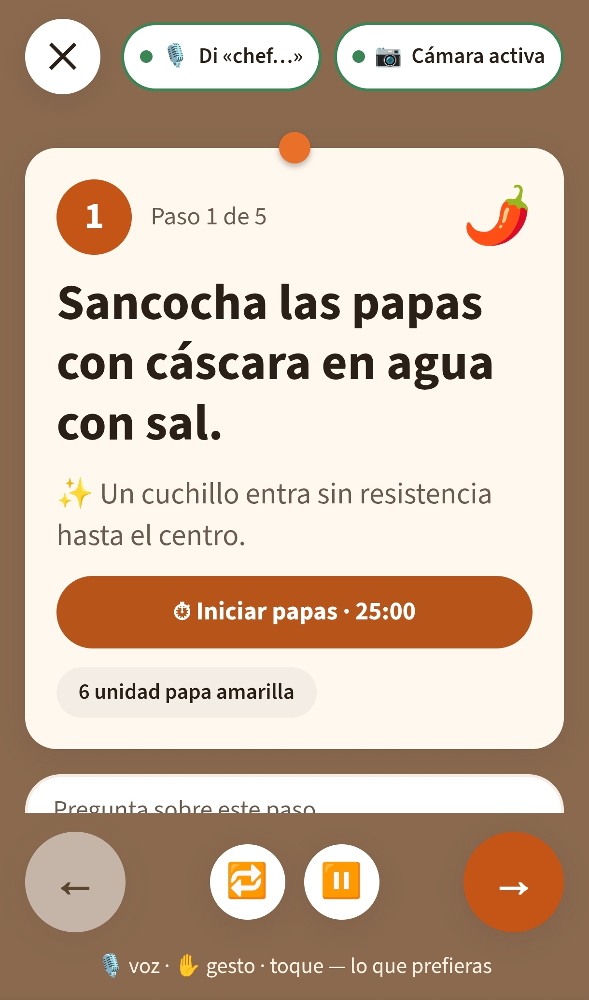

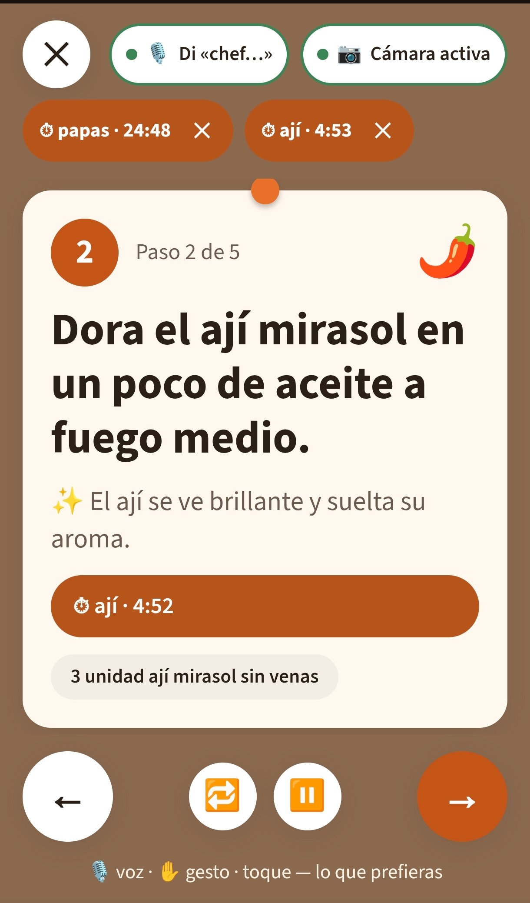

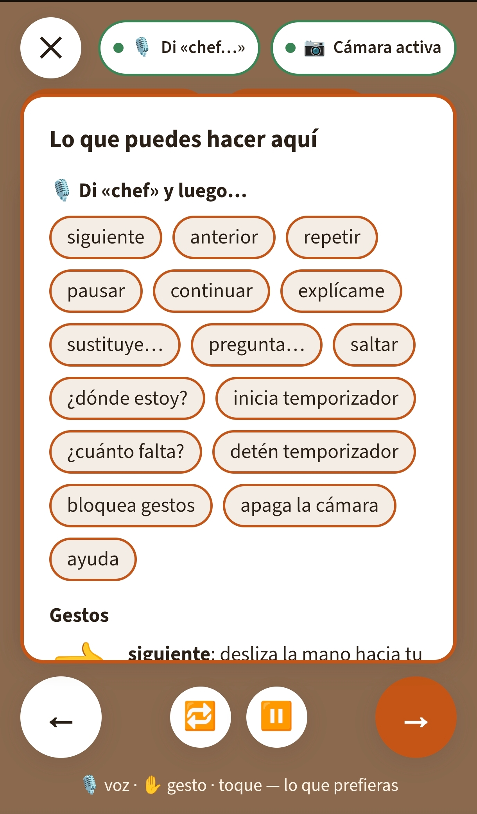

### E4 · Voz y E5 · Gestos

| HU | Req. | Estado | Evidencia |
|---|---|---|---|
| HU-13 Palabra de activación | RF-15, RF-18, RNF-01, RNF-04 | ✅ / ❌ | [`createWakeGate`](https://github.com/Akira-13/chef-en-el-aire/blob/main/app/src/input/voice/wakeWord.ts#L23) («chef»), lectura en voz [`speak`](https://github.com/Akira-13/chef-en-el-aire/blob/main/app/src/output/speech.ts#L66) breve o detallada, latencia medida · *no se mide la tasa de aciertos (RNF-04)* |
| HU-14 Pedir repetir | RF-19 | ✅ | [`createConfirmation`](https://github.com/Akira-13/chef-en-el-aire/blob/main/app/src/input/voice/confirmation.ts#L30): tras 2 fallos sugiere el gesto equivalente |
| HU-15 Gestos en el aire | RF-20, RNF-02, RNF-05 | 🟡 | [`startGestures`](https://github.com/Akira-13/chef-en-el-aire/blob/main/app/src/input/gestures/recognizer.ts#L36) con MediaPipe, **procesado 100 % en el dispositivo**; se miden los fps · *no se mide la tasa de aciertos (RNF-05)* |
| HU-16 Confirmar gesto y cámara | RF-21, RNF-11 | ✅ | [`ChannelStatus`](https://github.com/Akira-13/chef-en-el-aire/blob/main/app/src/input/ChannelStatus.tsx#L11) (indicador y botón de apagado), [`showGestureNotice`](https://github.com/Akira-13/chef-en-el-aire/blob/main/app/src/output/store.ts#L82) |
| HU-17 Evitar comandos de terceros | RF-22 | ✅ | Gesto de activación en [`interpretGestures`](https://github.com/Akira-13/chef-en-el-aire/blob/main/app/src/input/gestures/interpretGestures.ts#L79) y «bloquea gestos» con `lockGestures` · [test](https://github.com/Akira-13/chef-en-el-aire/blob/main/app/src/input/gestures/interpretGestures.test.ts) |

### E6 · Accesibilidad

| HU | Req. | Estado | Evidencia |
|---|---|---|---|
| HU-18 Movilidad reducida | RF-23, RF-24 | ✅ | Sensibilidad ajustable ([`SENSITIVITY`](https://github.com/Akira-13/chef-en-el-aire/blob/main/app/src/input/gestures/interpretGestures.ts#L37)) y aviso cuando no ve la mano ([`createHandWatcher`](https://github.com/Akira-13/chef-en-el-aire/blob/main/app/src/input/gestures/interpretGestures.ts#L180)) |
| HU-19 Uso solo con audio | RF-27, RNF-08 | ✅ / 🟡 | `aria-live` y el comando «dónde estoy» en [`createOutputService`](https://github.com/Akira-13/chef-en-el-aire/blob/main/app/src/output/index.ts#L19); áreas táctiles de 44 px y uso con teclado · *falta la revisión de WCAG 2.1 AA* |
| HU-20 Ver todo lo que suena | RF-17, RF-26 | ✅ | Un subtítulo para todo lo hablado y un ícono por sonido ([`OutputLayer`](https://github.com/Akira-13/chef-en-el-aire/blob/main/app/src/output/OutputLayer.tsx#L8)); alerta persistente del temporizador ([`TimerHost`](https://github.com/Akira-13/chef-en-el-aire/blob/main/app/src/cooking/TimerHost.tsx#L91)) |
| HU-21 Uso sin voz | RF-24, RNF-15 | ✅ | **Cada acción tiene ≥ 2 canales** ([`commandBus`](https://github.com/Akira-13/chef-en-el-aire/blob/main/app/src/core/commandBus.ts#L11)); si uno falla, [`reportFallback`](https://github.com/Akira-13/chef-en-el-aire/blob/main/app/src/input/fallback.ts#L19) avisa el cambio a otro |
| HU-22 Perfil de accesibilidad | RF-25 | ✅ | [`AccessibilitySettings`](https://github.com/Akira-13/chef-en-el-aire/blob/main/app/src/profile/AccessibilitySettings.tsx#L144): canal, verbosidad, fuente, contraste, volumen y tiempo de espera |

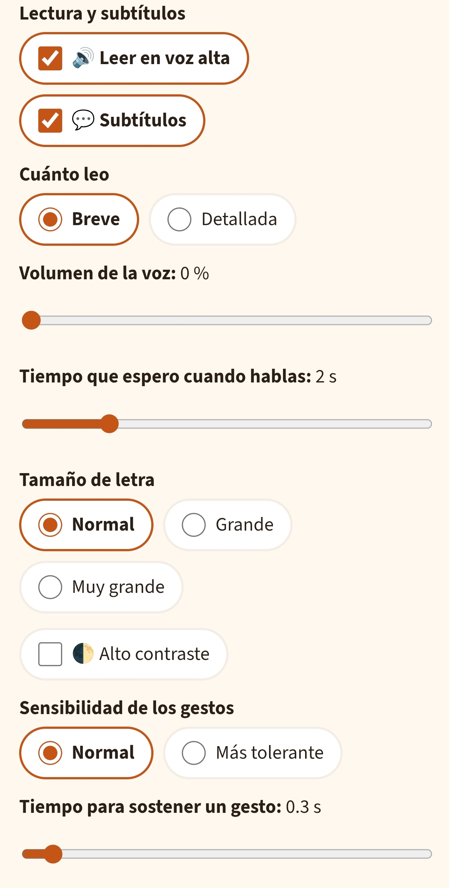

### E7 · Personalización continua

| HU | Req. | Estado | Evidencia |
|---|---|---|---|
| HU-23 Perfil persistente | RF-28, RNF-17 | ✅ | [`createProfileService`](https://github.com/Akira-13/chef-en-el-aire/blob/main/app/src/profile/index.ts#L41) guarda en IndexedDB y mide el tiempo de guardado · [test](https://github.com/Akira-13/chef-en-el-aire/blob/main/app/src/profile/index.test.ts) |
| HU-24 Aprender del uso | RF-29 | ✅ | [`applyUsageEvent`](https://github.com/Akira-13/chef-en-el-aire/blob/main/app/src/profile/learning.ts#L32): aprende de la lectura saltada, las sustituciones, las repeticiones y las calificaciones · [test](https://github.com/Akira-13/chef-en-el-aire/blob/main/app/src/profile/learning.test.ts) |
| HU-25 «Lo que aprendí de ti» | RF-30, RNF-11 | ✅ | [`LearnedSection`](https://github.com/Akira-13/chef-en-el-aire/blob/main/app/src/profile/ProfileSections.tsx#L78); **exportar en 1 paso, borrar en 2** ([`DataControls`](https://github.com/Akira-13/chef-en-el-aire/blob/main/app/src/profile/ProfileSections.tsx#L171)) |
| HU-26 Calificar / cuidador | RF-31, RF-32 | ✅ / ❌ | Calificación por gesto o por voz en [`CelebrationScreen`](https://github.com/Akira-13/chef-en-el-aire/blob/main/app/src/screens/CelebrationScreen.tsx#L47) · *el rol de cuidador está fuera del MVP* |

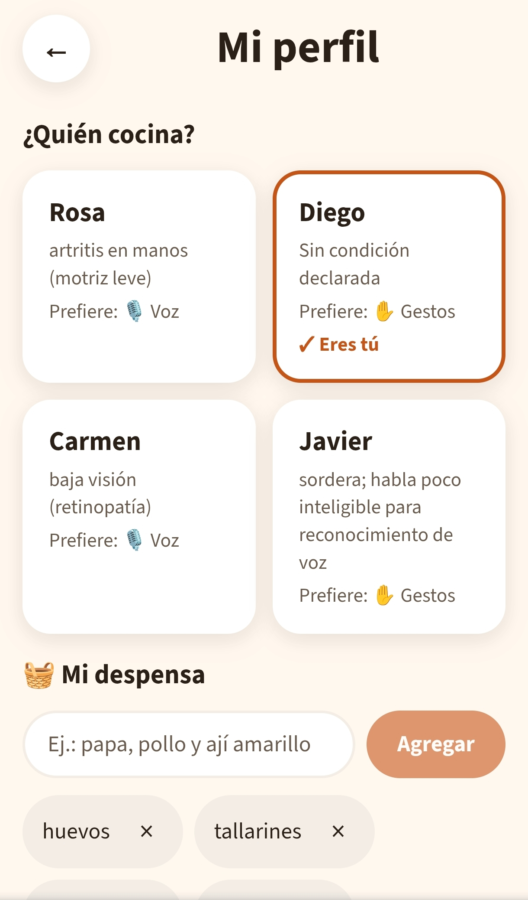

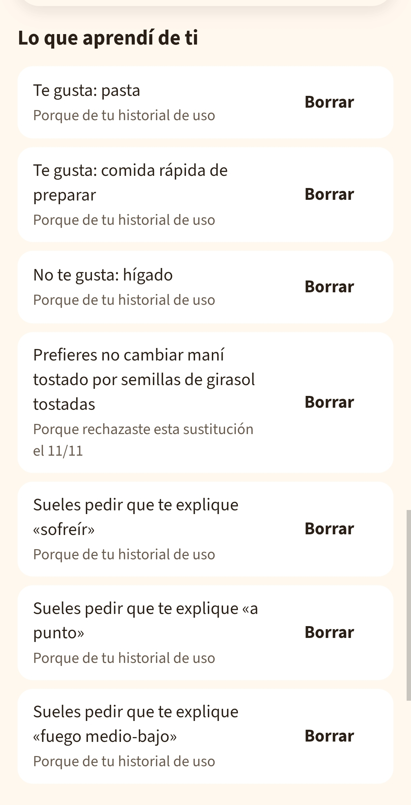 

### E8 · Multiusuario: ❌

HU-27 a HU-29 (RF-33 a RF-37, RNF-09) **no están implementadas**: no hay salas, servidor en tiempo real ni sincronización entre participantes. Su diseño solo existe en el [prototipo](https://github.com/Akira-13/chef-en-el-aire/blob/main/diseno/prototipo/4-sala-multiusuario.png).

### E9 · Diseño emocional (Norman)

| HU | Req. | Estado | Evidencia |
|---|---|---|---|
| HU-30 Visceral | RF-38 | ✅ | Paleta cálida y tema de alto contraste ([`tokens.css`](https://github.com/Akira-13/chef-en-el-aire/blob/main/app/src/theme/tokens.css), [`useThemeFromProfile`](https://github.com/Akira-13/chef-en-el-aire/blob/main/app/src/theme/useThemeFromProfile.ts#L6)) |
| HU-31 Conductual | RF-39 | ✅ | Sonido y animación para cada comando ([`playCue`](https://github.com/Akira-13/chef-en-el-aire/blob/main/app/src/output/sounds.ts#L63), [`showFlash`](https://github.com/Akira-13/chef-en-el-aire/blob/main/app/src/output/store.ts#L77)) |
| HU-32 Reflexivo | RF-40, RNF-16 | ✅ / 🟡 | Celebración de ≤ 5 s que se puede saltar ([`celebrationPlan`](https://github.com/Akira-13/chef-en-el-aire/blob/main/app/src/cooking/progress.ts#L41)) e historial «Mis platos» ([`MyDishes`](https://github.com/Akira-13/chef-en-el-aire/blob/main/app/src/profile/ProfileSections.tsx#L123)) · *falta el puntaje con usuarios* |
| HU-33 Tono del asistente | RF-41, RF-42 | ✅ / 🟡 | El tono se ajusta al nivel con [`TONE_BY_LEVEL`](https://github.com/Akira-13/chef-en-el-aire/blob/main/server/src/assistant/prompts.ts#L74) · *el nivel viene del perfil y se cambia eligiendo otro perfil de prueba; todavía no se edita en la app*; la emoción solo cuando la persona la declara ([`FEELING_SUPPORT`](https://github.com/Akira-13/chef-en-el-aire/blob/main/app/src/assistant/AssistantPanel.tsx#L55)) |

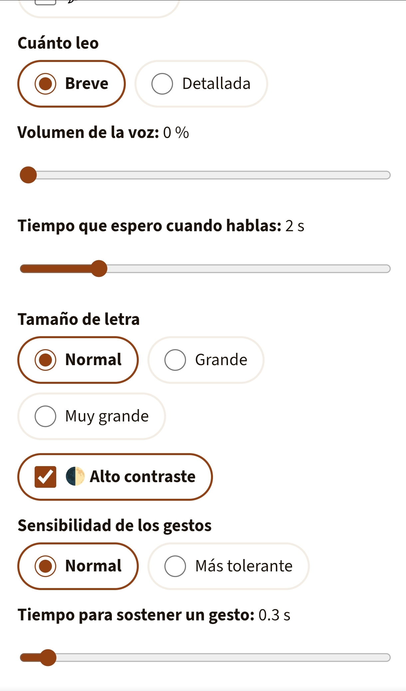

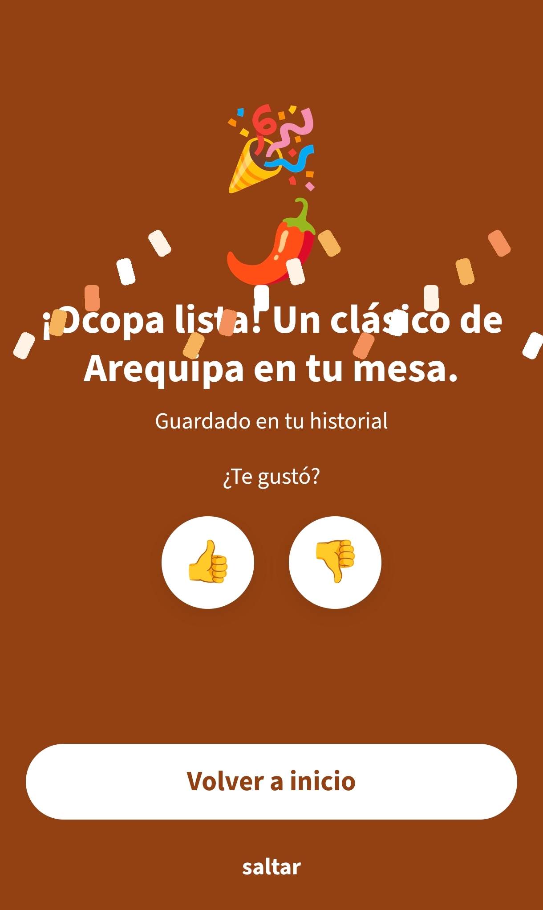

### E10 · PWA y calidad

| HU | Req. | Estado | Evidencia |
|---|---|---|---|
| HU-34 Instalar y uso offline | RF-43, RF-44, RNF-10, RNF-13 | ✅ / 🟡 | Manifest y caché de Workbox en [`vite.config.ts`](https://github.com/Akira-13/chef-en-el-aire/blob/main/app/vite.config.ts), [`useInstallPrompt`](https://github.com/Akira-13/chef-en-el-aire/blob/main/app/src/pwa/install.ts#L21) · *faltan Lighthouse y las pruebas entre navegadores* |
| HU-35 Falla de canal o de red | RF-10, RNF-15 | ✅ | [`OfflineBanner`](https://github.com/Akira-13/chef-en-el-aire/blob/main/app/src/ui/OfflineBanner.tsx#L8): **la receta, los temporizadores y el perfil siguen sin conexión** |
| HU-36 Onboarding | RF-14, RNF-12 | ✅ | [`OnboardingScreen`](https://github.com/Akira-13/chef-en-el-aire/blob/main/app/src/screens/OnboardingScreen.tsx#L51), práctica de voz y gestos · [test](https://github.com/Akira-13/chef-en-el-aire/blob/main/app/src/screens/OnboardingScreen.test.tsx) |
| HU-37 Métricas | RNF-01 a RNF-06 | 🟡 | Instrumentación en [`metrics.ts`](https://github.com/Akira-13/chef-en-el-aire/blob/main/app/src/core/metrics.ts#L28); los umbrales de aciertos se validan en las pruebas con usuarios |

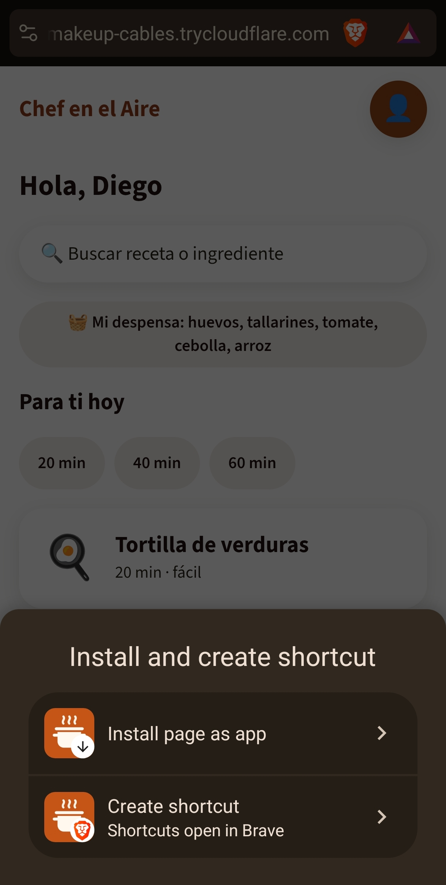

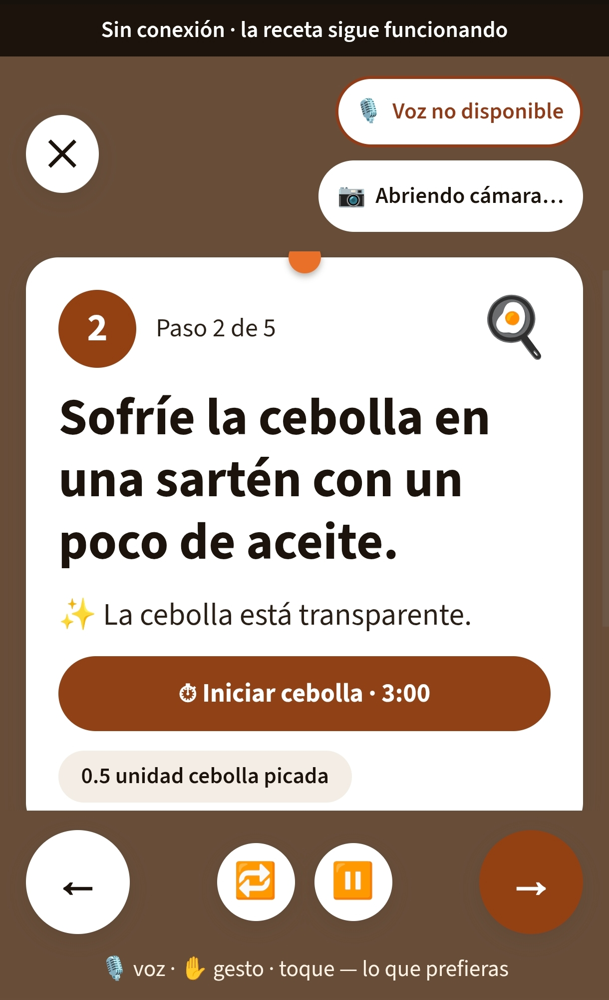

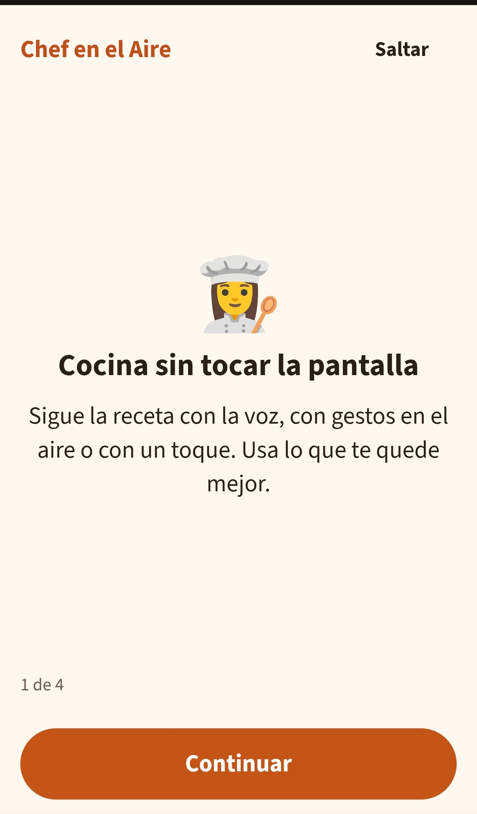

## 4. Pendientes

| Pendiente | Requerimientos | Siguiente paso |
|---|---|---|
| **Salas multiusuario** | RF-33 a RF-37, RNF-09 | Replantearlas como foros o espacios de discusión en la siguiente iteración |
| **Medir los aciertos de voz y gestos** | RNF-04, RNF-05 | Pruebas con usuarios |
| Detectar la emoción y adaptar el tono | RF-42 | Implementación |
| Revisión de WCAG 2.1 AA | RNF-08 | Auditoría |
| Lighthouse y pruebas entre navegadores | RNF-10, RNF-13 | Auditoría |
| Puntaje emocional | RNF-16 | Pruebas con usuarios |
| Perfil configurado por un cuidador | RF-32 | Fuera del MVP |
