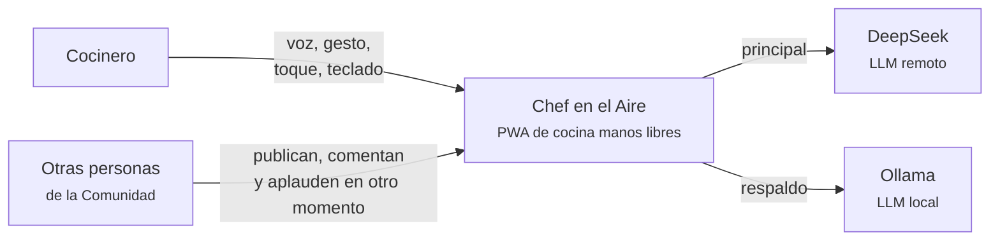
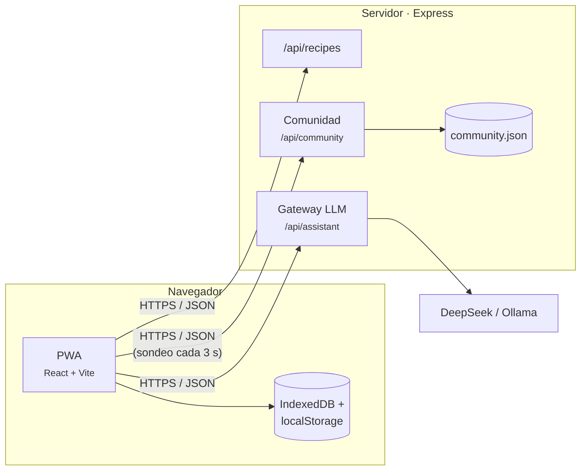
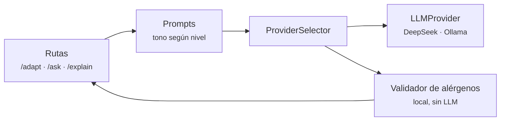
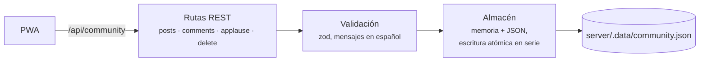
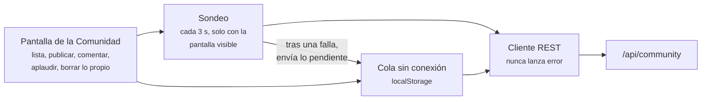
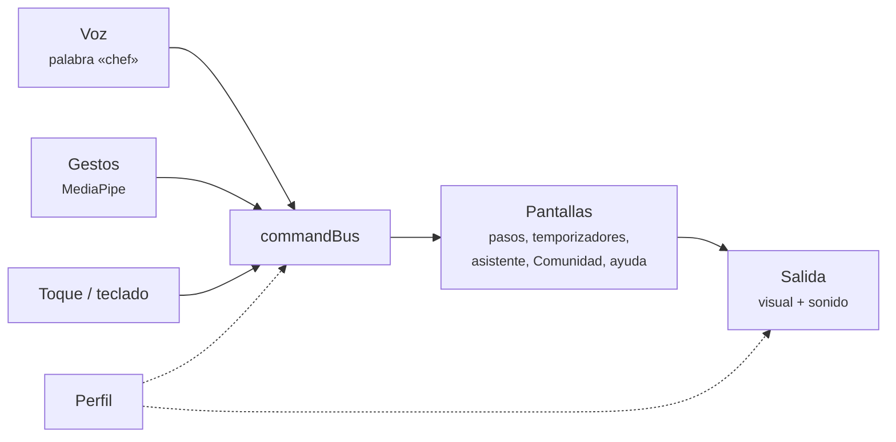

# Arquitectura implementada con la Comunidad (C4)

Muestra lo que **está construido** en la parte 4: la arquitectura de la [parte 3](../parte_3/arquitectura-c4.md) más la Comunidad, el espacio compartido asíncrono que reemplazó a las salas en tiempo real (ver [alcance](../../06-alcance.md), sección 4). El diseño original está en [docs/arquitectura](../../arquitectura/README.md).

## Nivel 1 · Contexto

Quien usa la Comunidad es la misma persona que cocina: lo que publica lo ven las demás cuando abren la pantalla, sin necesidad de coincidir en el horario.

## Nivel 2 · Contenedores

| Contenedor | Qué hace | Código |
|---|---|---|
| PWA | Pantallas, voz, gestos, salida multimodal, perfil y Comunidad; funciona sin conexión gracias al service worker | [`app/`](https://github.com/Akira-13/chef-en-el-aire/tree/main/app/src) |
| IndexedDB + localStorage | Perfil (IndexedDB); receta en curso, temporizadores y datos de la Comunidad en el dispositivo: clave del dispositivo, ids de lo propio y cola sin conexión (localStorage) | [`profile/storage.ts`](https://github.com/Akira-13/chef-en-el-aire/blob/main/app/src/profile/storage.ts), [`community/storage.ts`](https://github.com/Akira-13/chef-en-el-aire/blob/main/app/src/community/storage.ts) |
| `/api/recipes` | Sirve el recetario de `datos/recetas.json` | [`server/src/app.ts`](https://github.com/Akira-13/chef-en-el-aire/blob/main/server/src/app.ts) |
| Gateway LLM | Adapta recetas, responde dudas, explica pasos | [`server/src/assistant`](https://github.com/Akira-13/chef-en-el-aire/tree/main/server/src/assistant) |
| Comunidad | Publicaciones, comentarios, aplausos y borrado de lo propio; guarda todo en un archivo JSON | [`server/src/community`](https://github.com/Akira-13/chef-en-el-aire/tree/main/server/src/community) |

El paquete [`shared/`](https://github.com/Akira-13/chef-en-el-aire/tree/main/shared/src) lo usan tanto el cliente como el servidor. Ahí están los tipos, los comandos, la detección de alérgenos, el escalado de porciones y el contrato de la Comunidad ([`community.ts`](https://github.com/Akira-13/chef-en-el-aire/blob/main/shared/src/community.ts): rutas, límites y tipos). **Ninguna de esas reglas depende del LLM.**

## Nivel 3 · Componentes

### Gateway LLM

- **Respaldo:** si el proveedor principal falla o tarda más de 8 s, se usa el alterno. Si este también falla, el servidor responde «no disponible» y el cliente sigue mostrando la receta original (RF-10).
- **Agregar un proveedor:** basta con un adaptador nuevo que implemente [`LLMProvider`](https://github.com/Akira-13/chef-en-el-aire/blob/main/server/src/llm/LLMProvider.ts) (RNF-14).
- **Alérgenos:** el validador revisa toda receta adaptada y bloquea las que contengan alérgenos del perfil (RF-07, RNF-06).

### Comunidad · Servidor

- **Rutas:** `GET /posts`, `POST /posts`, `POST /posts/:id/comments`, `POST /posts/:id/applause` y `DELETE /posts/:id`. Los errores son `400` con un mensaje en español, `403` al borrar lo ajeno, `404` si la publicación no existe y `503` si falla el disco (RF-33 a RF-37).
- **Almacenamiento:** las publicaciones viven en memoria y se guardan en el archivo de `COMMUNITY_FILE` (por defecto `server/.data/community.json`). Cada cambio se escribe en un archivo temporal y se renombra, y las escrituras se encadenan para que dos pedidos no se pisen. Se conservan 200 publicaciones como máximo y 200 comentarios por publicación; el archivo se siembra con dos publicaciones de demostración.
- **Sin duplicados:** cada publicación y comentario trae un `clientId`; si llega otra vez, el servidor devuelve el existente en lugar de crear uno nuevo (RNF-09).
- **Privacidad:** la `deviceKey` del dispositivo se guarda con hash SHA-256 y nunca se devuelve. Sirve para que cada dispositivo aplauda una vez por publicación y solo pueda borrar lo suyo.
- **Seguridad:** el servidor está expuesto por el túnel, así que valida la forma completa de lo recibido, incluida la receta publicada, con el mismo esquema del recetario.

### Comunidad · Cliente

- **Sondeo:** la lista se consulta cada 3 s solo mientras la pantalla está visible. Sin servidor, se conserva lo último cargado y se avisa que la Comunidad no está disponible.
- **Cola sin conexión:** publicar, comentar y aplaudir entran primero a la cola y se envían enseguida. Lo que no llega se reintenta con una espera creciente (de 2 s hasta 60 s) y se descarta tras 6 intentos fallidos. También se envía al reconectar (RF-37, RNF-09).
- **Cliente que no lanza error:** igual que el del asistente, si la red falla devuelve «no disponible» y la pantalla sigue con lo cargado.
- **Medición:** el cliente registra cuánto tarda en verse lo que publican otras personas, con la hora del servidor, para comprobar RNF-09.

### PWA · Modo cocina

- **Todos los canales publican el mismo comando** en [`commandBus`](https://github.com/Akira-13/chef-en-el-aire/blob/main/app/src/core/commandBus.ts). Gracias a eso, cada acción se puede hacer por al menos dos canales (RF-12, RF-24). La pantalla de la Comunidad también reacciona a esos comandos: se recorre con «siguiente» y «anterior», y se aplaude por voz, gesto o toque (RF-36).
- **Privacidad:** el video de la cámara no sale del dispositivo (RNF-11).

## Decisión: asíncrono en vez de WebSocket

La Comunidad usa REST con sondeo y no una conexión permanente. Un servidor en tiempo real y las pruebas con varios dispositivos a la vez no caben en el tiempo restante, y cocinar con otros no exige coincidir en el horario. El costo es un retraso de unos segundos entre lo que alguien publica y lo que ven los demás, dentro del umbral de RNF-09.

## Diferencias con el diseño

| Diseño | Implementado |
|---|---|
| Servidor de salas (WebSocket) | No existe. Se reemplazó por la Comunidad: REST con sondeo y cola sin conexión |
| Base de datos en el servidor | Archivos JSON (recetario y publicaciones de la Comunidad); el perfil vive en el dispositivo |
| Claude como LLM remoto | DeepSeek, con Ollama como respaldo |
| — | Nuevo paquete `shared/` con reglas comunes y el contrato de la Comunidad |
